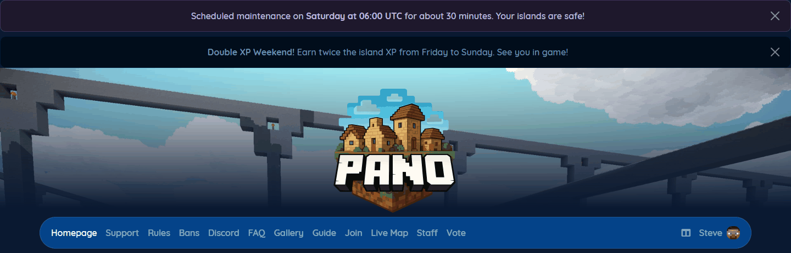
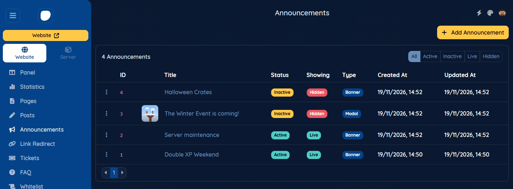

  
  <h1>Announcements</h1>
  
<b>Tell every visitor what's new, right at the top of your website.</b>

  

    
    
    
  

Announcements lets you share news with everyone who visits your Pano website. Put a banner at the top of every page for an event or a sale, or show a pop-up with an image for something big, like a new season.

## ✨ Features
- 📢 **Banners and pop-ups**: Use a slim banner at the top or a pop-up window with an image.
- 🎨 **Colors and effects**: Pick a color, the text alignment and an optional scrolling or flashing effect.
- ⏰ **Scheduling**: Start an announcement at a set time and let it end on its own.
- 📍 **Where it shows**: Show it on every page or only on the home page.
- 🔗 **Links**: Send players to a page on your site or to another website.
- ❌ **Closable**: Let players close a banner, and show a pop-up only once if you like.
- 🧩 **Several messages**: Add more than one message to a single banner.

## 📸 Screenshots

<i>A pop-up announcement with an image for a big event.</i>

<i>See which announcements are live, hidden or inactive.</i>

## 🚀 Get started
1. Open your Pano panel and go to **Addons**.
2. Find **Announcements** and click **Install**.
3. Open **Announcements** in the panel and click **Add Announcement**.

## 💬 Support
Questions or ideas? Join our [Discord](https://panomc.com/discord) or visit [panomc.com](https://panomc.com).

## 📄 License
Released under the GPL-3.0 License.
